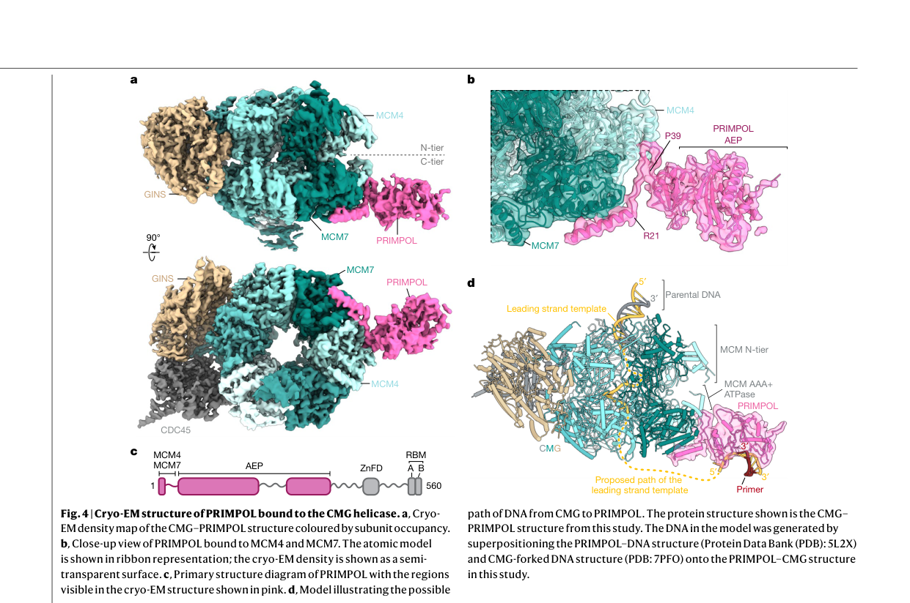

**背景解读（深度模式）** | 目标论文：Park J, Lynch LD, Blanco-Romero E, Masdemont-Maestro R, Méndez J & Chistol G. *The molecular basis of replication fork restart via repriming by PRIMPOL*. Nature (2026), DOI 10.1038/s41586-026-11276-y [1]。
**交叉引用：** 同源《The molecular basis of replication fork restart via repriming by PRIMPOL_文献解读.md》（同目录）已完成逐图证据审计（主图46 panel + ED 48 panel）；本文件不重做逐图精读，只补PDF之外的谱系、传承、增量定位与跨文献问题精研，并吸收文献解读§五(三)埋下的6个交接问题。凡"本文做了什么"的陈述均与文献解读一致、可回溯目标PDF；凡"领域/作者/前作"的陈述均带外部来源[n]。
**核证边界：** 本文件为 **paper-background-research v1.4 增量打磨版**（2026-11-14，在v1.2回归修订版〔2026-11-13，对标用户提供的基准综述 report_primpol_background_zh.md [64] 修订〕基础上增量打磨：阅读顺序精确到figure、核心因子课本化背景补充、文体自引清理与星号审计；原有内容全部保留，修订前版本备份于工作目录）。作者履历以Stanford Profiles[8]、Chistol实验室官网tools/news/people页[9,41,60–63]、CNIO组页[10]与**Méndez个人CV页[40]**为准；基金以NIH RePORTER API记录为准[11,12]；前作实验室归属与历史文献题录以EuropePMC REST（含core摘要）批量核证为准[13–28,43–59]；结构主张以RCSB PDB条目逐一核对物种/核酸/配体为准[3–7]。并行工作（companion）以同文件夹内其PDF全文+RCSB记录核证[2]。在线发表日期以EuropePMC `firstPublicationDate`核证（2026-11-11），PDF清样占位符不作为"未发表"依据（上线日期一律以期刊页/数据库核证为准）。历史叙述整合参考基准综述[64]，其中本轮未能独立复核的训练细节逐项标注"参考报告提供"。未能核实项在文末诚实列出。

---

## Pillar A：文章背景简报

### A.0 范围、方法与证据分类（v1.2回归新增）

本简报采用**聚焦的叙述性检索**而非系统综述：以PRIMPOL/PrimPol/CCDC111、repriming、RPA、CMG、复制叉逆转、复制后缺口、CHK1/ATR为主题，围绕目标论文refs与基准综述[64]线索纳入约50篇关键原始研究/综述（文末[1–63]，含数据库与官方页记录），检索截止2026-11-13；未做效应量合并，不保证穷尽全部文献。来源类别：期刊文章页/EuropePMC REST（题录+core摘要+`firstPublicationDate`）、RCSB PDB、NIH RePORTER API、机构官方页（Stanford Profiles、Chistol lab tools/news/people、CNIO组页与个人CV页）。历史文献（1968–2024）本轮以EuropePMC核证题录与完整摘要，叙述整合参考基准综述[64]；**逐文献阅读深度见文末索引表**，承诺"仅书目或摘要级来源不承载超出其摘要的实验细节，未读到的实验细节不补写"。

以下四类陈述分别处理、不混用"证明"：(i) **实验直接观察**（如两文独立co-IP、30AR实验密度、单分子停留时长census）；(ii) **由缺失/回补支持的功能机制**（如Pol ε/δ双耗竭上位性、界面突变梯、细胞回补）；(iii) **作者提出的解释模型**（如双锚定simultaneity、两阶段募集、CTF18遮蔽假说）；(iv) **尚待验证的治疗/转化设想**（如MCM4界面阻断肽、PRIMPOL抑制增敏）。证据力度不同，行文以"建立/推断/未知"三分标注。

### A.1 The paper at a glance（一瞥）

完整题录：Park, J., Lynch, L. D., Blanco-Romero, E., Masdemont-Maestro, R., Méndez, J. & Chistol, G. The molecular basis of replication fork restart via repriming by PRIMPOL. *Nature* (2026), DOI 10.1038/s41586-026-11276-y；EuropePMC已收录正式记录PMID 43015470 [1,39]。**在线发表日期2026-11-11**（EuropePMC core `firstPublicationDate`核证[39]；所给PDF清样首页"Published online: xx xx xxxx"为占位符，**不具权威性**，不能据此判断"尚未发表/未分配"），Received 14 May 2026, Accepted 7 October 2026，非预印本；尚无卷期页码（在线先发）。PDF与公开检索中未见bioRxiv预印本历史（未核实项，见文末）。公共数据：原始单分子/ensemble数据与自研MATLAB代码存Stanford Digital Repository（DOI 10.25740/hy921dn6469，公开），source data随文；本文无GEO/测序accession、无新PDB/EMDB deposition（引用他人PDB 7PFO）[1]。通讯与lead contact：Gheorghe Chistol（chistol@stanford.edu）[1,8]。同期companion：Polo Rivera, C., Roske, J. J., Hands, E. L., Fassetta, F., Sale, J. E. & Yeeles, J. T. P. Human replisomes direct a dedicated leading-strand primase for fork restart. *Nature* (2026), DOI 10.1038/s41586-026-11204-0, PMID 43015477 [2]；其结构坐标PDB 30AR于2026-11-11释放（EMD-57508–57512）[3]——即两篇Nature同日（2026-11-11）上线、结构数据同步公开，应视为互补的同期进展而非把机制首创性归给其中一篇[64]。

### A.2 The authors（作者谱系）

**Gheorghe Chistol（通讯）**。Stanford医学院Chemical and Systems Biology助理教授，Bio-X与Stanford Cancer Institute成员[8]。训练路径是"物理→单分子→复制"：MIT物理学士（2007）、UC Berkeley物理/生物物理博士（2013）、Harvard Medical School博士后（Biological Chemistry and Molecular Pharmacology系；Jane Coffin Childs博士后 fellowship 2014–2017）[8]。**博士导师为Carlos J. Bustamante**——基准综述引UC Berkeley eScholarship学位论文记录明确列出（本轮eScholarship直连403未能复核原文，标注"参考报告提供"），旁证为Liu, Chistol, Cui & Bustamante合著的eLife 2018环状ATPase马达SpoIIIE单分子研究[42]，博士课题方向（φ29 DNA包装马达/环状ATPase亚基协作）与本文的方法学联系是**测量分子机器动态过程的能力**，而非博士阶段即研究PRIMPOL[64]。**博士后导师Johannes Walter已由实验室tools页官方证实**（"As a postdoc in Johannes Walter's lab at Harvard Medical School, Gheorghe Chistol developed KEHRMIT"[41]，不再仅是发表记录推断；Sparks et al. Cell 2019中Chistol第二作者、Walter通讯亦为旁证[24]）。谱系再上溯一层：Walter本人是在UCSD的**Newport实验室**做博士后期间建立了爪蟾核质提取物（NPE）[41]，Walter, Sun & Newport 1998确立无需完整细胞核的可溶性染色体DNA复制体系[44]——本文的extract平台正源于这条"Newport→Walter→Chistol"传承。技术命名须区分：Chistol博士后期间发展的解旋酶实时成像方法名**KEHRMIT**（Kinetics of the Eukaryotic Helicase by Real-time Molecular Imaging and Tracking，GINS荧光亚基标记），nascent-DNA标记方法**PhADE**（Fen1–mKikGR融合，Anna Loveland在Walter与van Oijen实验室发展）[41]；本文使用的平台名为**KERMIT**（KEHRMIT的扩展），早期名与本文名不可混写。早年荣誉包括2002年国际物理奥赛银牌、Berkeley优秀研究生 Instructor（2008）[8]；公开profile未见顶级奖项（如HHMI/named professorship），如实不写。独立后的资助主线是NIGMS R35（MIRA）GM147060 "Structure-Function Analysis of DNA Replication Initiation Factors Implicated in Disease"，RePORTER记录FY2022（1R35）至FY2026（5R35）连续在资[11]——本文的"复制机器结构-功能"取向正是该MIRA标题的直接延伸。本文另致谢NCI P01 CA092584支持[1]；RePORTER显示该P01为多项目DNA修复程序（总PI John A. Tainer），其中FY2022–2024的Project 4 "Fork Repair: Mechanisms and consequences of stalled replication fork processing" PI为David K Cortez[12]——而Cortez正是本文ref 22（CHK1磷酸化PRIMPOL）的通讯[18]，本文致谢亦专门感谢Cortez对CHK1部分的意见[1]。Chistol在该P01中的具体角色未出现在RePORTER的PI/co-PI字段，故只陈述"资助网络重叠+Cortez参与讨论"，不断言其项目归属。实验室官网显示其研究主线为：应激下复制解旋酶的控制、**经复制传递表观遗传信息**、泛素化调控的基因组维护[8,9]——第二条主线与表观遗传/染色质研究方向存在天然接口（见A.6与B4）；官网并披露正在招募cryo-EM人才开辟结构方向[9]，这解释了本文为何把原子结构留给companion而自守功能遗传学+单分子动力学。研究弧线定位见A.3。官网新闻（2026年9月系 retreat）记载Jinho Park以本文（当时embargo中的Nature稿）获系"Best Paper"[9]。

**Juan Méndez（共同资深）**。CNIO（西班牙国家癌症研究中心）Molecular Oncology Programme下DNA Replication Group组长[10]。**个人CV页核证的训练履历**[40]：Universidad Autónoma de Madrid（UAM）生物化学与分子生物学学士（1990）与博士（1995），博士期间在Centro de Biología Molecular "Severo Ochoa"随**Margarita Salas**研究噬菌体DNA复制，博士论文获UAM First Class Honours、Real Academia de Doctores的Premio Juan Abelló与Glaxo Wellcome生物医学研究奖；1997–2004在冷泉港**Bruce Stillman**实验室做博士后（Fundación Ramón Areces/HFSP/美国国防部乳腺癌计划资助），研究人ORC、Cdc6、MCM及cyclin E失调对复制的影响；**2004年10月**获Ramón y Cajal计划研究合同并受聘CNIO Molecular Oncology Programme初级组长[40]。基准综述另引一份公开学术介绍列Salas与**Luis Blanco**共同指导、并把独立建组记为2005年[64]——Blanco共同指导本轮未在CV页复核（标注"参考报告提供"），2004聘任与2005建组可能是两个节点，不强行合并。其学术出身可追到复制许可（licensing）奠基圈：Méndez & Stillman, Mol Cell Biol 2000（第一作者）报道人ORC/Cdc6/MCM的染色质结合周期[29]——即ORC–licensing谱系。他是PRIMPOL repriming的共同发现者：2013年四篇发现论文中，Mourón et al. NSMB 2013（本文ref 1）由Méndez通讯（Blanco共同作者）[13]，García-Gómez et al. Mol Cell 2013（ref 2）由Blanco通讯、Méndez与Holt参与[14]。此后其团队建立PRIMPOL细胞遗传学平台：HCT116 PRIMPOL-KO细胞、人PRIMPOL单抗106E/71D（本文Methods）[1]，ICL traverse工作González-Acosta et al. EMBO J 2021（ref 13，Blanco-Romero第二作者）[27]，并参与Quinet et al. Mol Cell 2020（Vindigni通讯，Méndez与Sale共同作者）[19]与应激造血干细胞repriming工作Jacobs et al. Mol Cell 2022（CNIO组页列为组产出，作者含组成员González-Acosta、Guarino）[21,10]。CNIO组页当前三条线：复制起点调控（含AURKA新函数）、与NYU Rothenberg实验室合作的PRIMPOL超分辨成像、与CBM Lecona合作的p97–Pol α–ATR轴（Nat Commun 2025）[10]。资助为MICIU PID2019-106707-RB与PID2022-142771NB-100（本文funding声明）[1]；公开检索未见Chistol–Méndez联合基金记录，故不写"联合资助产物"。学位与论文奖项已由个人CV页核证[40]（见上）；更高奖项（如HHMI/named professorship）公开检索未见，如实不写。一个有趣但不能过度解释的交叉：Chistol博士研究φ29包装马达、Méndez博士研究噬菌体DNA复制，两人都与噬菌体分子机器有渊源，但这**不构成彼此间的师承关系**（前者偏马达生物物理、后者偏复制酶学）[64]。**本文对Méndez而言是"回到自己2013年发现"的一步**：发现repriming十三年后，用单分子生物物理合作者补上自己当年留下的机制缺口。

**Jinho Park（第一作者）**。Chistol实验室现任博士后（官网people/news），截至2026年10月正在求职faculty[9,60]；本文除DNA fibre外全部实验、全部蛋白纯化（除GINS/Pol δ/Pol ε）、MATLAB分析由其完成（author contributions）[1]；资助为Stanford医学院Dean's Fellowship（官网2022年12月帖证实其时已在组[63]）与美国癌症学会博士后 fellowship PF-26-1595977-01-PF[1]；亦为Lynch et al. Cell 2026第二作者[26]；2026年9月以本文（当时embargo中的Nature稿）获系retreat "Best Paper"[61]。**训练背景**：官网people页载其家乡Gwangju（韩国）、既往方向"single-molecule spectroscopy, TIRF, CRISPR-Cas9"、现方向"How RPA affects DNA replication dynamics"[62]——与基准综述所述"本科Gwangju Institute of Science and Technology（GIST）、博士首尔大学化学系（单分子FRET研究CRISPR–Cas9靶标特异性）、2022年加入"一致[64]，但**学位单位与加入年份本轮未在官方页逐字复核**（people页未列学位；标注"参考报告提供+方向旁证"）。本轮未找到足够直接的博士导师声明，**不据共同发表论文补填导师姓名**。

**Luke D. Lynch（第二署名作者，与第三署名Blanco-Romero等贡献）**。PDF等贡献脚注仅覆盖Lynch与Blanco-Romero二人，**不含第一作者Park，故非"共同一作"**（等贡献脚注范围逐字核对，回归更正）。Chistol实验室前研究生（官网），Lynch, Park & Chistol Cell 2026（"Metazoan lagging-strand DNA synthesis is distributive"，PMID 42913629）第一作者[26]；本文负责GINS、Pol δ、Pol ε重组表达纯化与GINS–LD655标记（contributions）[1]——即Fig. 4d回补实验的物质基础；NIH T32GM007276支持[1]。**毕业后赴Harvard Medical School Walter实验室做博士后已由官网2026年10月news帖官方证实**（"recently started his postdoc in the Walter lab at Harvard Medical School"[60]），形成"Chistol（Walter博士后出身）→学生回Walter组"的谱系闭环。基准综述记其博士年份2019–2025[64]，本轮未在官方页逐字复核（标注"参考报告提供"）。

**Elena Blanco-Romero（第三署名作者，与第二署名Lynch等贡献）**。等贡献脚注范围同上（不含Park，非"共同一作"）。CNIO博士生（FPU16/02977；EMBO Scientific Exchange Grant 2021-9148，本文funding）[1]；与Masdemont-Maestro在Méndez指导下完成全部DNA fibre实验与分析（contributions）[1]。Chistol实验室people页alumni列"Elena Blanco（visiting scholar, fall 2021）"[62]，与EMBO交换资助年份互证——两组的合作有实际人员交流基础，而非仅挂名。发表记录落在Méndez组复制重启/基因组稳定主线：González-Acosta et al. EMBO J 2021第二作者（PRIMPOL与ICL traverse）[27]、Muñoz et al. EMBO J 2024第二作者（RAD51限制再激活起点过度复制）[28]。

**Roberto Masdemont-Maestro**。CNIO博士生（FPU20/0328）[1]；fibre实验共同执行者（contributions）[1]；独立发表记录未核实。

**Companion作者（并行工作上下文）**。Polo Rivera、Roske、Hands、Fassetta、Sale、Yeeles，MRC Laboratory of Molecular Biology（Cambridge）[1,2]。Yeeles的主线是"纯化蛋白重建复制机器"：酵母replisome、人replisome快速复制（Baris et al. Nature 2022）[36]、人replisome结构（Jones et al. EMBO J 2021, PDB 7PFO）[32]、Pol α–primase靶向（Jones et al. Mol Cell 2023, PDB 8B9D）[33]、Pol ε–PCNA持续合成与校对切换（Roske & Yeeles NSMB 2024, PDB 9F6D）[34]、酵母TLS重建（Guilliam & Yeeles NSMB 2020）[30]。Sale的主线是TLS/PRIMPOL细胞生物学：Šviković et al. EMBO J 2019（R-loop限制，Sale通讯）[22]、Quinet 2020共同作者[19]。两人训练细节未核实，不写。

**核心因子课本化背景（v1.4新增，研究史/谱系视角）。** 分子性质与本文用法的自足注释见文献解读"一、基础概念注释"，此处不重复概念细节，只补三个核心因子"从哪来、缺了会怎样"的研究史底色。**PRIMPOL**：古菌-真核引物酶（AEP）超家族的引物酶-聚合酶，2013年由四个实验室独立鉴定为repriming执行者（逐篇差异化见A.3）[13–16]；de novo引物合成与DNA延伸双活性、无校对、错误倾向高（前向突变谱示插入/缺失突出）[14,48]，核/线粒体双重定位[14]。缺失后果的研究史阶梯：细胞对UV/顺铂等损伤敏感、复制推进受损[15,19]；链间交联下单叉穿越失败、更依赖两叉汇聚与备用起点，KO小鼠对MMC超敏[27]；应激造血干细胞增殖依赖repriming[21]；KRAS压力下ATR–PRIMPOL轴维持耐受，缺失迫使慢性依赖易错Rev1–Pol ζ并损害适应度[20,59]。疾病相关性：BRCA缺陷细胞适应性上调PRIMPOL与顺铂耐受关联[19]、repriming缺口与PARP抑制剂敏感关联（目标论文refs 18–20）[1]——这是"抑制PRIMPOL增敏"治疗提议的谱系基础，但均止于细胞/动物模型，无临床验证。**CMG（CDC45–MCM2–7–GINS）**：真核复制解旋酶，人源核心replisome结构（7PFO）与11因子纯化重建确立其复制机器中枢框架[32,36]；解旋酶失活即叉推进终止，故其速度签名（解偶联减速→再耦联加速）可作重启的功能判读[24,54]。本文语境中MCM4/MCM7 C-tier是PRIMPOL的docking位点（companion 30AR实验密度）[2,3]；谱系上CMG研究正从"它如何解链"走向"它如何部署辅助因子"，本文与companion是后一步。**RPA（RPA1–RPA2–RPA3异源三聚体）**：真核主要ssDNA结合蛋白，快速包被解偶联产生的ssDNA并作为ATR–CHK1检查点信号平台[45]；单分子力谱给出其在叉上的动态解离（koff=0.006 s⁻¹，体外数值，向extract迁移为推断）[37]。与PRIMPOL的关系史：2013年Wan示直接结合RPA1、招募依赖该互作[16]；2017年两篇生化给出条件化图景——RBM-A/B介导的低覆盖促进/饱和抑制[17]与底物长度依赖效应[51]。缺失后果：RPA本身为复制与检查点所必需（课本级共识，本轮未核证专门原始文献）；就本通路而言，PRIMPOL失去RPA结合（ΔRPA/ΔRBM）即失去染色质募集与高效重启[1,16,17]——"RPA必需性"的条件依赖正是B3跨文献张力所在。

### A.3 The scientific lineage — what this builds on（研究谱系/传承）

**第一条弧：Chistol的"单分子看见复制"四步。** 直接地基是Sparks et al. Cell 2019（ref 25，Walter实验室时期，2018在线/2019卷期）：确立CMG可绕过DNA-蛋白交联、解偶联时CMG减速的速度签名、以及KEHRMIT成像雏形（本文扩展为KERMIT，命名区分见A.2）[24,41]；第二步Terui et al. Cell 2024（ref 71，独立后）：GLRT单分子事件检测与后生动物双向复制起始机制[25]；第三步Lynch et al. Cell 2026（ref 66）：后随链distributive合成（每个冈崎片段需新鲜Pol α/Pol δ），挑战trombone模型，并产出本文回补实验所需的Pol δ/ε试剂[26]；**本文是该弧线的第四步——从"正常复制"推进到"复制应激与重启"**，把速度签名读out反转为"慢→快=重启"的功能判据。这条弧线的方法论连续性（同一extract平台、同一GLRT、同一速度换算）是本文空间-动力学结论可信度的来源。

**第二条弧：PRIMPOL从发现到机制的十三年（总览）。** 2013年四个独立实验室同时发现repriming（逐篇差异化见下）：Méndez（Mourón, ref 1）[13]、Blanco（García-Gómez, ref 2）[14]、Doherty（Bianchi, ref 3）[15]、Huang（Wan, ref 4）[16]。随后Doherty/Chazin给出RPA–PRIMPOL界面RBM-A/B与RPA的**条件化**调控（Guilliam 2017, ref 30：低覆盖RPA促进priming、饱和包被抑制）[17]，Blanco给出底物长度依赖的RPA效应与Pol ε延伸协同（Martínez-Jiménez 2017, ref 31）[51]——两者并非"直接冲突"，而是不同底物长度/RPA覆盖度/加样顺序下的表面张力，本文双锚定模型在复制叉语境给出统一的空间解释（见B3）；Cortez给出CHK1–S255磷酸化促进repriming与201–260自抑制环（Mehta 2022, ref 22），摘要明言"irrespective of the type of replication stress"，但同时报告激活以ssDNA缺口形成为代价、组成性活性降低细胞适应度[18]——作用域与代价当时未解。**本文同时收编这两段旧账**：用双锚定模型解释RPA矛盾的作用条件（远端完全包被=抑制 vs 叉附近双锚定=刺激），用双模式框架把CHK1效应限定到次模式。

**第三条弧：领域"知其然不知其所以然"的旧观察。** 前导链repriming假说2013年即提出（ref 2）但无直接证据[1]；"PRIMPOL只作用于停滞叉而非转录/重组ssDNA"与RPA普遍存在矛盾[1]；解偶联产生RPA–ssDNA（Byun 2005, ref 28[45]；Taylor & Yeeles 2018/2019, refs 26,27[53,54]）；真核Pol α–primase被靶向到后随链、故前导链需要专用引物酶（酵母Aria & Yeeles 2019 ref 42；人Jones 2023）[1,33]。本文给前三条补上分子机制，第四条则是companion与本文共同的逻辑起点。

**并行收敛：companion（Sale/Yeeles）**。同一问题、正交体系：纯化人replisome+CPD损伤+终点生化+ cryo-EM（30AR, 3.3 Å）[2,3]。目标论文Discussion明确披露撰稿期间得知该工作（personal communication）[1]。两篇互证CMG募集必需与前导链特异性，但在RPA必要性上给出表面相反的结论（见B3）——这种"收敛中有张力"正是本期JC最有讨论价值的点。

**史前概念层（1968–2011）：现象先于酶（v1.2回归新增）。** "留缺口继续复制"的概念远早于PRIMPOL的鉴定。Rupp & Howard-Flanders（1968）描述切除修复缺陷大肠杆菌UV后新生DNA的不连续性，是复制后缺口研究的历史来源之一；注意EuropePMC收录的是其**2005重印**（PMID 15889457），不可误作原始发现年，且该实验不能用于证明人PRIMPOL的存在[43]（仅书目级）。Walter, Sun & Newport（1998）建立无需完整细胞核的可溶性爪蟾卵提取物复制体系，使复制许可/起始可被分步操纵——本文extract平台的直接体系祖先（非PRIMPOL研究）[44]。Byun et al.（2005，Walter/Cimprich）在爪蟾体系示UV/顺铂可使MCM解旋与聚合解偶联，阻止解偶联削弱CHK1磷酸化，且解偶联本身不足以解释全部检查点激活（还需Pol α相关合成）——"聚合酶受阻→解旋继续→ssDNA与检查点"的机制基础，不应简化为"只要ssDNA就必然完全激活CHK1"[45]。Lopes, Foiani & Sogo（2006）用电镜/二维凝胶在出芽酵母观察UV后叉附近及叉后的ssDNA区与缺口，支持损伤下游重新起始与后续填补，TLS与同源重组减少缺口积累——但**出芽酵母不含PRIMPOL**，不能把该表型倒推为该酶活性[46]。Elvers et al.（2011）在人成纤维细胞发现普通DNA纤维检测示UV后复制速度仅轻度下降（Pol η缺陷细胞也未显示长期普遍停叉），而另一种检测DNA连续延长的方法显示明显阻断——提示复制可经损伤后重新起始继续，且**纤维轨迹长度≠连续DNA完成**；当时未识别执行酶[47]。

**2013年四篇发现论文的差异化（v1.2回归新增）。** 四篇不应被压缩成"同一件事被重复发现"，它们分别回答不同问题：García-Gómez et al.（Mol Cell，Blanco通讯）——"人细胞是否存在Pol α–primase之外的从头起始能力？"鉴定PRIMPOL的脱氧核苷酸de novo起始+聚合能力与核/线粒体双重定位[14]；Mourón et al.（NSMB，Méndez通讯）——"复制恢复依赖直接跨损伤还是另起引物？"功能分离变体（锌指变体保留体外旁路却不能恢复受阻复制）把关键功能指向primase而非仅TLS[13]；Bianchi et al.（Mol Cell，Doherty通讯）——"与已知UV耐受途径是什么关系？"PRIMPOL对UV后复制推进有作用，与Pol η缺失的遗传关系并非简单同路线性通路；当年仍保留直接TLS与重新引发两种解释空间[15]；Wan et al.（EMBO Rep，Huang通讯）——"酶怎样被带到需要的位置？"hPrimpol1/CCDC111直接结合RPA1、招募依赖该互作，细胞功能同时需要RPA结合与引物合成[16]。本文的CMG定位是在既有RPA招募模型上补充"复制机器特异定位"，而非把RPA作用从零发现。

**2014–2017：为什么必须限制活性，以及RPA的条件化角色（v1.2回归新增）。** Guilliam et al.（NAR，2014在线/2015卷期，Doherty）以两种前向突变实验示PRIMPOL错误倾向高（尤其插入/缺失），RPA与mtSSB在相应体外体系限制其活性——由此提出关键问题：既然PRIMPOL能解救复制又有错误风险，细胞怎样让它只完成必要的短距离合成？本文强调随后交给Pol ε正是回应这一风险[48]。Schiavone et al.（Mol Cell，2015在线/2016卷期，Doherty/Sale）在DT40 BU-1位点与体外G4底物示PRIMPOL可在结构下游重新引发、却不能有效直接复制稳定G4，催化/锌指功能缺失致局部表观遗传不稳定——把研究对象从外源损伤扩展到内源二级结构[49]。Kobayashi et al.（Cell Cycle 2016，Doherty/Sale）以鸟类细胞遗传学+体外重启示引物合成功能比所测TLS功能更能解释链终止核苷条件下的恢复——原有新生链末端已不能延伸时，改善"读过受损模板"并不解决所有问题[50]。Guilliam et al.（Nat Commun 2017，Doherty/Chazin）定位C端两个RPA结合基序RBM-A/B（RBM-A对招募尤其重要），其浓度梯度示**低于模板饱和量的RPA促进priming、高量RPA完全占据ssDNA时抑制**——故该文本身并非单纯主张"RPA抑制PRIMPOL"[17]。Martínez-Jiménez, Lahera & Blanco（Sci Rep 2017）示短ssDNA上竞争显著（RPA可抑制）、允许两蛋白同时结合的较长底物/M13 ssDNA上可出现促进，并示**Pol ε可延伸PRIMPOL产生的引物、RPA增强该反应**——已提供"PRIMPOL起始→Pol ε延伸"的生化可行性，但无完整CMG叉，故空间靶向未知[51]。两篇2017的共同难题：核内RPA丰富，PRIMPOL如何在可用ssDNA被覆盖前找到正确位置？模板长度、RPA覆盖度、加样顺序与组分均影响体外结果，不能用一句"RPA到底促进还是抑制"取代条件化解释（见B3）。线粒体平行线：Torregrosa-Muñumer et al.（PNAS 2017）示PRIMPOL参与受损mtDNA的复制再起始——repriming不限于核，但线粒体用Twinkle/Pol γ/mtSSB等不同机器，核内CMG–Pol ε模式不可直接照搬[52]。

**2018–2019：真正的复制机器改变问题尺度（v1.2回归新增）。** Taylor & Yeeles（Mol Cell 2018）以纯化酵母复制系统示前导链受阻与后随链受阻后果不同，核心机器在一定条件下也能在前导链损伤后重新引发但效率较低[53]；后续研究（JMB 2019）强调前导链延伸停止本身足以使解旋减速、造成较长停顿，并非必须先加入特异性损伤信号蛋白[54]——为本文判断"解偶联慢速→重新耦联快速"提供机制背景。**酵母不含PRIMPOL**，不能把稀少重启解释成PRIMPOL效率低。Sparks, Chistol et al.（Cell，2018在线/2019卷期）在爪蟾提取物实时成像CMG越过某些DNA-蛋白交联后明显减速——这条技术线的重要性在于允许区分"解旋酶在哪里"与"新生DNA是否增长"，不再仅凭终点胶图推断叉状态[24]。

**2020–2021：缺口命运与路径网络（v1.2回归新增）。** Quinet et al.（Mol Cell 2020，Vindigni/Méndez/Sale）在BRCA缺陷模型示反复顺铂暴露提高PRIMPOL表达与染色质募集，DNA纤维/S1敏感性/电镜支持重新引发增加、复制叉逆转减少、叉后ssDNA缺口增多，从而避免部分逆转叉的病理性降解——"保护叉"在这里可能不是让同一个逆转结构更牢固，而是**减少进入该结构的机会**；这是本文浓度效应的重要前史，但细胞实验不能直接等同于已证实的患者耐药机制[19]。Bai et al.（Mol Cell 2020，Cimprich）示HLTF缺失细胞叉逆转不足、核苷酸受限时更依赖PRIMPOL维持推进，不同HLTF突变体的替代路线不完全相同（可涉及REV1）——失去一种应对机制后细胞可能改用另一种，纤维速度"正常"不意味着所有修复功能正常[55]。Piberger et al.（Nat Commun 2020，Doherty/Méndez/Petermann）以BPDE等大体积加合物示PRIMPOL生成的复制后缺口经MRE11/EXO1相关处理可成为RAD51介导同源重组的底物，低损伤负荷时RAD51信号可主要来自缺口而非可检测的断裂——**不能仅凭RAD51焦点断定叉已崩溃**[56]。González-Acosta, Blanco-Romero et al.（EMBO J 2021，Méndez）示PRIMPOL重新引发促使单叉在链间交联下游恢复，缺失时更依赖两叉汇聚、对交联药物更敏感——"穿越/恢复复制"须与"交联化学结构已被移除"区分；这也是本文CNIO团队的直接前史[27]。Tirman et al.（Mol Cell 2021，Vindigni/Zou）以改造DNA纤维实验示顺铂后补缺在S期与G2期依赖不同组合：G2涉及RAD18、PCNA单泛素化与REV1–Pol ζ，S期还涉及UBC13与RAD51（REV1–Pol ζ同样参与），BRCA1/2也影响补缺——重新引发的最终效果由"生成缺口"与"填补缺口"的共同能力决定，而非PRIMPOL活性单独决定[57]。

**2022–2026：调控开关、内源压力与空间机制的直接检验（v1.2回归新增）。** Mehta et al.（Sci Adv 2022，Cortez）以细胞复制检测/激酶实验/磷酸化测定/功能回补示CHK1磷酸化S255促进所测条件下的重新引发，201–260替换变体支持自抑制模型；摘要明言"irrespective of the type of replication stress"，并报告激活以ssDNA缺口形成为代价、组成性活性降低细胞适应度——自抑制解除的精细结构未定，磷酸模拟变体不等同天然、可逆、定量受控的磷酸化[18]。Baris et al.（Nature 2022，Yeeles）以11种因子/43条多肽建立高效人复制系统，解析Pol ε/PCNA/CTF18-RFC/TIM-TIPIN/CLASPIN/AND-1的作用——非PRIMPOL功能论文，而是2026年companion的平台铺垫[36]。Igarashi et al.（Nat Commun 2023，Zou/Shiotani）在上皮模型示KRAS激活伴随转录相关异染色质压缩与复制困难，ATR–CHK1–PRIMPOL S255轴支持耐受并伴随缺口与不稳定；患者表达/生存关联是补充线索，不证明抑制PRIMPOL已有临床获益[20]。Mellor et al.（NAR 2024，Sale）在非转化、p53完整人细胞以CRISPR遗传互作示PRIMPOL与REV1、Pol η及PCNA K164相关复制后通路互相影响，确保"on-the-fly"与复制后旁路之间的稳健交接——重新引发能连接当前复制与后续补缺，限制缺口长度的解释属机制模型[58]。**同组最新后续：Igarashi et al.（Nat Commun，2026-10-01在线，Shiotani）**提出PRIMPOL在KRAS压力中不只是"推动复制"：急性期未磷酸化PrimPol与SMARCAL1协作主动减速、稳定受挑战的叉并限制易错合成，持续压力下经ATR依赖磷酸化切换为促进重新引发（减速减弱）；PrimPol缺失迫使细胞慢性依赖易错的Rev1–Pol ζ合成并损害适应度[59]。**该"减速–重新引发"的功能态/时间态二分，与本文"CMG近端–远端"的空间模式二分不是同一种分类轴，不得混写**。2026年11月两篇Nature（本文+companion）共同把PRIMPOL功能定位到核心复制机器[1,2]。

**贯穿以上历史的阅读原则。** (i) DNA纤维上的长轨迹可跨过显微分辨率以下的小缺口——轨迹更长不自动意味着新生DNA更连续、更准确或基因组更安全（Elvers 2011已以检测学差异提示，2020后S1核酸酶纤维/电镜强化）[47,19,56]；(ii) repriming位点决定的初始缺口可被后续切除/填补/重组改变——细胞测到的缺口长度不得仅解释为"起始位点离损伤多远"[57,56]；(iii) "复制恢复"与"损伤修复完成"是两件事[13,57]；(iv) "保护叉"可能是减少进入脆弱结构的机会，而非稳固该结构[19]。

**领域的四次问题转换（v1.2回归新增）。** 这一领域的进展不是"发现一个新聚合酶→解析结构"，而是经历四次问题转换：从观察复制后不连续DNA到识别PRIMPOL（1968–2013）；从证明酶活到区分重新引发与直接TLS（2013–2016）；从单酶机制到认识逆转与补缺网络（2017–2021）；最后才走向复制机器如何精确部署PRIMPOL（2022–2026）。因此本文最值得记住的不是"PRIMPOL能重启复制"这一早已有之的结论，而是：**通用ssDNA招募信息不足以解释精确定位，CMG联系、局部驻留与后续高保真聚合酶接续，使重新引发成为可调控的复制叉操作**——这一认识由两篇同期研究从不同证据方向支持，但RPA必需性的条件依赖、真实核内浓度、缺口命运与体内模式占比仍未完全解决[1,2,64]。

### A.4 What's genuinely new here（新在哪，相对前作与companion）

1. **实时动力学 census（相对2013细胞遗传学与companion终点生化）**：在extract中直接数出>99%的PRIMPOL结合为远端秒级瞬态、非生产性；生产性结合=叉附近~3 min长停留、先于~70±10%重启；PRIMPOL解离后3–5 min叉才重启（Park et al., Fig. 2c–h and Extended Data Fig. 3j）[1]。高时间分辨率实验并提示：低帧率下看似在ssDNA上"滑行"的连续亮点可能来自不同分子先后结合，不能只凭连续亮点断言长距离一维扩散[1,64]。companion无时间分辨率，2013文献无单分子——这是本文独占的证据层。
2. **双模式四维解耦与检查点作用域重划（相对Mehta 2022）**：浓度（3–100 nM）×MCM4界面（DED）×聚合酶上位性（Pol ε/δ）×磷酸化突变体（S255A/E/D、Δ201–260）干净分离主/次模式，并把"CHK1促进repriming"精确化为"只放大次模式"（Park et al., Fig. 4b–f）[1,18]。
3. **MCM4界面的extract+人细胞双重遗传学（与companion互证但读out不同）**：3A/DED/29–35:Linker三正交突变在结合时长、co-IP、ensemble、HCT116 fibre四层一致（Park et al., Fig. 3）[1]；companion独立用结构+loop突变梯+TK6 pcnaK164R顺铂敏感回补验证（Polo Rivera et al., Fig. 5c–g）[2]。本文独占的是"停留时长"这一动力学表型。
4. **近生理浓度窗揭示模式切换（与companion滴定互补）**：以OpenCell全细胞~17 nM为锚采样3–100 nM，发现>10 nM才启用次模式（Park et al., Fig. 4b）[1]；companion滴定0.1–20 nM发现RBM在≤1 nM才重要（Polo Rivera et al., Fig. 5f）[2]——两个浓度轴合起来才完整。
5. **前导链特异性的实时空间证据**：重启后RPA信号减半=只清除一条链的RPA（Park et al., Fig. 2a）[1]；companion以近损伤位点mapping（近单核苷酸分辨率）独立证实（Polo Rivera et al., Fig. 2）[2]。
6. **治疗提议**：以N端MCM4界面阻断肽/分子抑制repriming（Discussion末段）[1]——无化合物验证，属靶点提名。

**Companion独占增量（对照用）**：原子结构30AR（N端1–21 helix–MCM7、22–39 loop–MCM4沟槽+AEP桥）[2,3]；gap尺寸最小化的定量论证与引物序列偏好[2]；**位点定位显示在所用模板上多数重启距损伤不足约50 nt**——这是特定序列与重构条件下的结果，**不能直接宣布所有细胞内PRIMPOL缺口都短于50 nt**（初始缺口≠最终缺口）[2,64]；RPA在纯化体系高浓度下非必需[2]；TLS缺陷背景下顺铂耐受的细胞验证[2]。

### A.5 Caveats worth keeping in mind（须留意的局限）

体系边界：extract无染色质/表观语境，flow-cell DNA浓度10⁻³–10⁻² ng/µl低于检查点阈值~1 ng/µl故单分子实验中检查点不激活（本文以ATRi ensemble互证，但"检查点非必需"的细胞外推仍受限）[1]。人PRIMPOL–蛙MCM4跨物种界面：MSA保守性+人细胞fibre支持，但无蛙PRIMPOL功能验证、无人源co-IP（companion为人源结构，可补但非本文数据）[1,2]。核内真实PRIMPOL浓度未知（OpenCell 17 nM含线粒体池），"近生理"是操作定义[1]。结构主张的证据等级：本文Fig. 3a为AF3预测模型、companion Fig. 4d的DNA路径为5L2X+7PFO叠合模型、Fig. 6b"与Pol ε无冲突"为8B9D+7PFO+9F6D+30AR复合叠合模型——**三者都不是含DNA/RPA/Pol ε的实验三元复合物结构**；30AR本身无DNA、ZnF与RBM不可见[2,3,4,5,6,7]。RPA必要性两文表面矛盾未机制性裁决（B3）。次模式生理权重未测（无癌细胞内源过表达测量、无模式分区读out）[1]。3A在细胞fibre因重复间变异大未达显著；EREDED六突变因酶活受损弃用（MCM7贡献未干净解耦）[1]。统计n为叉/事件数而非生物学重复（生物学重复=2次extract制备、ensemble/co-IP/fibre 3–4次）[1]。co-IP MCM7/Flag为相对富集而非化学计量[1]。无PRIMPOL小分子抑制剂验证（"目前无抑制剂"为本文陈述，引refs 17,63）[1]。**（v1.2回归新增）**异源体系边界：以重组人PRIMPOL补入爪蟾提取物，内源蛙PRIMPOL未被检测到**不等于已证明绝对不存在**；Pol α去除主要用于高通量机制研究，与定义的前导链损伤正交验证不能视为完全相同的压力[1,64]。磷酸模拟变体（S255E/D）不等同天然、可逆、定量受控的磷酸化，"组成性活跃"变体虽促进带压力复制却可降低细胞生长/克隆形成（Mehta 2022已报告适应度代价）[18]。Igarashi 2026的"急性减速协作 vs 持续压力重引发"是**功能态/时间态**二分，与本文"CMG近端 vs 远端"的**空间模式**二分不是同一种分类轴，二者不可互相替代[59]。初始缺口≠最终缺口：repriming位点决定的初始缺口可被后续切除/填补/重组改变，细胞缺口长度不应仅解释为起始位点离损伤多远；companion"<50 nt"限于特定模板[2,57]。纤维轨迹长度≠新生DNA连续性/准确性[47]。"抑制潜在错误合成"的结论主要来自PRIMPOL短程参与+高保真聚合酶接续的机制推断，**不等同于本文已直接测得全基因组突变率下降**[1,64]。

### A.6 In short（收束）

本文是**Chistol把"单分子看见复制"弧线（Sparks 2019→Terui 2024→Lynch 2026）推进到复制应激territory、并与Méndez十三年前自己发现的repriming通路合流**的一步——主张"PRIMPOL不是RPA–ssDNA上的随机引物酶，而是被CMG（MCM4/MCM7）与RPA双锚定、停在解偶联解旋酶出口处的前导链专用引物酶，引物直接交Pol ε以压缩易错合成；过表达/CHK1才解锁远端Pol δ次模式"，并以此解释为何repriming只发生在停滞叉、为何RPA丰富仍允许引发、以及CHK1文献效应的作用域；与Yeeles/Sale的纯化体系+cryo-EM companion同期互证，共同把PRIMPOL确立为replisome的整合组件与可药性靶点。对表观遗传背景的JC读者而言，Chistol profile中"经复制传递表观遗传信息"这条实验室主线[8]是本文与表观遗传方向最自然的讨论接口。

---

## Pillar B：面向读者的问题精研

**问题清单**（吸收文献解读§五(三)交接问题1–5；问题6"检查点是否flow-cell伪影"已在文献解读内就地作答，此处并入B4）：
B1 MCM4/MCM7界面与"双锚定"的结构证据到底有多硬？跨物种界面成立吗？
B2 引物交给Pol ε是"直接捕获"还是经CTF18-RFC/Pol δ桥？
B3 为何ΔRPA在爪蟾extract失败、而ΔRBM在纯化人体系重启正常？RPA到底必需与否？
B4 次模式（CMG非依赖/Pol δ）在真实细胞/癌症中的生理权重与CHK1作用域？
B5 PRIMPOL为何在引物合成后、重启前3–5 min解离？它是否随CMG行进？

### B1 界面与双锚定的结构证据硬度

**分层拆解**：(i) PRIMPOL是否物理结合CMG；(ii) 结合在哪个亚基/哪些残基；(iii) 相对解旋酶出口与Pol ε的几何；(iv) 是否与RPA"同时"结合（双锚定的 simultaneity）。

**跨文献证据**：(i) 两文独立pull-down/co-IP：本文N端1–60 bait拉下MCM2–7、界面突变削弱（Park et al., Fig. 3d,e）[1]；companion全长PRIMPOL与CMG特异pull-down（Polo Rivera et al., Fig. 3e）[2]。(ii) companion cryo-EM 30AR（3.30 Å，人源，EMD-57512）给出实验密度：N端21-aa α-helix（1–21）结合MCM7、紧随的~20-aa loop（22–39）夹在MCM4浅沟与AEP域之间（Polo Rivera et al., Fig. 4a–c）[2,3]；突变梯Δ1–21温和缺陷（且最靠近CPD的起始事件损失不成比例）、GS22–39或6A loop完全丧失重启、2A loop（Y28/R29）比3A loop（R31/L32/S33）更严重（Polo Rivera et al., Fig. 5c–e）[2]。本文突变集（R29/R31/K34→3A/DED；29–35 linker）与companion突变集（Y28/R29；R31/L32/S33；22–39 linker）**重叠但不相同**，两者在"loop 22–39 + MCM4/MCM7 C-tier"上收敛——这是跨体系、跨突变设计的互证，而非同一实验的重复。(iii) AEP域侧向邻接MCM中央孔出口（前导链模板出口）（Polo Rivera et al., Fig. 4b）[2]；但**30AR不含DNA**：Fig. 4d的DNA路径是把PRIMPOL–DNA晶体（5L2X, 2.2 Å, Rechkoblit et al. 2016）与CMG–fork DNA（7PFO, 3.2 Å, Jones et al. 2021，含Pol ε/TIM-TIPIN/CLASPIN/AND1）叠合到30AR上的**模型**[3,4,5,31,32]；本文Fig. 3a右的7PFO叠合同理[1]。"与Pol ε无空间冲突"来自companion Fig. 6b的复合叠合模型（8B9D+7PFO+9F6D+30AR）[2,6,7,33,34]，不是实验三元复合物。(iv) 两文都**没有**PRIMPOL同时结合RPA与CMG的直接观察：30AR中无RPA、ZnF与RBM因柔性不可见（Polo Rivera et al., Fig. 4c灰色区）[2,3]；本文三色实验无CMG通道[1]。跨物种：本文界面为人PRIMPOL–蛙MCM4盐桥（R29–E469/R31–D678/K34–E674；人MCM4对应E474/D683/E679），MSA显示人/蛙/鼠/鸡保守（Park et al., Extended Data Fig. 4a,b）[1]；companion为人–人结构[2,3]——保守性+人源结构+两文人细胞遗传学共同支持，但蛙体系本身无内源PRIMPOL功能验证（extract不含蛙PRIMPOL既是优势也是边界）[1]。

*图来源：Polo Rivera et al. Nature 2026, Fig. 4a–d [2]。阅读警示：a/b为实验cryo-EM密度+原子模型（蛋白only，30AR无DNA）；c中粉色为可见区（helix+loop+AEP），灰色ZnFD/RBM为**不可见**区；d的黄色虚线DNA路径与红色primer为5L2X+7PFO叠合**模型**，非实验密度——不得把d当作"解析了PRIMPOL–CMG–DNA三元结构"。*

**逐环分级**：(i) Strong（两体系独立生化）；(ii) Strong（实验结构+两套正交突变梯）；(iii) Moderate（出口邻接为实验密度，DNA路径与Pol ε兼容性为叠合模型）；(iv) Moderate-to-weak（双锚定simultaneity为模型推断）。**建立/推断/未知三分**：CMG锚定=建立；出口几何=建立（蛋白部分）+推断（DNA路径）；RPA同时锚定=推断；RBM在结构中的构象=未知。
**最强单一实验**：companion 30AR + GS22–39完全丧失重启的突变梯（Polo Rivera et al., Fig. 4b, 5c）[2]。**其限度**：静态、无DNA/RPA/Pol ε；不能证明simultaneity、不能给出结合动力学、不能排除RPA在生理浓度下的贡献。
**还缺什么**：CMG–PRIMPOL–RPA–ssDNA四元复合物cryo-EM；或extract中PRIMPOL与CMG（GINS通道）双色单分子共定位/共停留测量——后者正是Chistol平台能做而companion不能做的实验。

### B2 引物交接：直接捕获 vs CTF18-RFC vs Pol δ桥

**分层拆解**：(i) 谁延伸引物（Pol ε vs Pol δ）；(ii) 以什么路径交接（PRIMPOL→Pol ε直接；PRIMPOL→CTF18-RFC→Pol ε；PRIMPOL→Pol δ延伸→到CMG处转Pol ε）；(iii) 交接的时间窗（3–5 min延迟里发生什么）。

**跨文献证据**：(i) 本文双耗竭上位性：Pol α+δ耗竭仅轻微降CMG依赖重启、Pol α+ε耗竭消除之、100 nM Pol ε回补完全恢复；镜像地Pol δ耗竭消除次模式、400 nM回补恢复（Park et al., Fig. 4d）[1]——**延伸者身份**在两模式间干净分离。companion纯化体系中Pol ε执行前导链主体合成、重启后需Pol ε reengage（Polo Rivera et al., Fig. 1, Discussion）[2]。**Pol ε延伸PRIMPOL引物的生化先例早在Martínez-Jiménez 2017即已提供**（纯化蛋白、无CMG叉，RPA增强该反应）[51]——本文的新意在复制叉语境、空间定位与聚合酶分工，而非首次证明Pol ε能延伸该引物。(ii) 路径未裁决：companion明确列两条替代路径——直接交给前导链PCNA装载器CTF18-RFC再给Pol ε，或Pol δ先延伸引物直到CMG处再转Pol ε；后者在酵母TLS重建中有先例（Guilliam & Yeeles NSMB 2020，companion ref 31）[2,30]。本文Pol δ耗竭仅轻微影响主模式，排除"Pol δ为必需中间体"于extract主模式，但**不排除CTF18-RFC介导的直接路径**，也未测CTF18依赖性[1]。结构侧：9F6D给出Pol ε–PCNA–DNA开放构象（3.6 Å）[7,34]、8B9D给出replisome–Pol α（3.4 Å）[6,33]，但无PRIMPOL–Pol ε或PRIMPOL–CTF18实验复合物；"无冲突"仅为叠合模型[2]。(iii) 时间窗：本文Δt2（PRIMPOL解离→重启）中位~5 min（Pol α耗竭）/~3 min（损伤底物）（Park et al., Extended Data Fig. 3j）[1]；两文均无Pol ε或CTF18荧光通道，延迟内的分子事件未知。
**逐环分级**：延伸者身份 Strong（两体系遗传学/生化一致）；交接路径 Moderate-to-weak（两条替代路径并存，酵母先例支持Pol δ桥在TLS语境存在）；时间窗现象学 Strong、机制 Weak。
**建立/推断/未知三分**：延伸者身份（主Pol ε/次Pol δ）=建立；CTF18-RFC介导或Pol δ桥路径=推断（两文并列的替代假说）；3–5 min延迟内的分子事件=未知。
**最强单一实验**：本文Pol α+δ vs Pol α+ε双耗竭+生理浓度回补（Park et al., Fig. 4d）[1]。**其限度**：耗竭移除整个聚合酶而非"捕获功能"分离突变；不能区分直接捕获与CTF18介导；Pol δ桥在主模式被排除为必需、但在TLS/次模式语境仍可能运作。
**还缺什么**：extract中CTF18耗竭/RFC装载突变对重启的影响；Pol ε捕获缺陷分离突变体；单分子加Pol ε或CTF18通道直接看交接瞬间。

### B3 RPA必要性：两文表面矛盾的裁决

**分层拆解**：(i) extract中RPA互作是否必需；(ii) 纯化体系中是否必需；(iii) 浓度依赖如何调和；(iv) 细胞中RBM的作用；(v) 矛盾的机制解释是否唯一。

**跨文献证据**：(i) 本文ΔRPA（D519R/F522A/D551R/I554A）不上染色质（Park et al., Extended Data Fig. 2d,e）、几乎无ssDNA结合（Fig. 2d,e）、30 nM不重启（Fig. 1j,k）[1]。(ii) companion ΔRBM（双RBM删除）与RBM-ARA在20 nM标准条件下重启效率与位点pattern均=WT（Polo Rivera et al., Fig. 3b,c）[2]。(iii) 但companion滴定显示WT仅在0.1 nM才下降、ΔRBM在1 nM即受损、0.1 nM几乎不可测（Polo Rivera et al., Fig. 5f）[2]——RBM=低浓度下的局部浓度模块；本文3 nM标记WT重启~40% vs 30 nM ~75%亦显示extract的浓度敏感性（Park et al., Extended Data Fig. 3i）[1]。(iv) 细胞中RBM-A为染色质定位与RS下叉前进所必需：Guilliam 2017（Doherty/Chazin）[17]、Wan 2013（Huang）[16]、companion引refs 9,11,16,17[2]。**（v1.2回归新增）RPA的体外作用本身是条件化的**：Guilliam 2017的浓度梯度示低于模板饱和量的RPA促进priming、高量RPA完全占据ssDNA时抑制[17]；Martínez-Jiménez 2017示短ssDNA上RPA竞争抑制、允许两蛋白同时结合的较长底物/M13上可促进[51]。因此"RPA必需/非必需"必须带底物长度、RPA覆盖度、加样顺序与组分限定——两文的表面矛盾应放进这个条件化框架，而非择一采信（跨文献张力显式并列）。(v) 调和模型：companion提出两阶段募集——低亲和、瞬态的RPA互作把低丰度PRIMPOL定位到活跃复制 locus（类比E. coli Pol IV–SSB–β夹的TLS募集，Chang et al. NSMB 2022，companion ref 33）[2,35]，CMG互作负责前导链定位；本文双锚定模型与之兼容但强调simultaneity[1]。**矛盾未被完全裁决**：本文ΔRPA在30 nM仍失败，而companion ΔRBM在20 nM正常——浓度差不足以解释；候选解释（均为假说）包括：extract含染色质与长段RPA–ssDNA竞争/隔离、纯化forked底物ssDNA短且CMG近旁、两文突变等位基因不同（四点点突变 vs 双RBM删除）、extract中RPA密度更高。Guilliam 2017的RPA–PRIMPOL为低亲和瞬态互作[17,2]，与"RPA=浓度模块"自洽。
**逐环分级**：extract必需 Strong；纯化高浓度非必需 Strong；浓度依赖调和 Moderate-to-strong（滴定直接支持）；细胞RBM必需 Strong（多实验室）；统一机制模型 Moderate（coherent但跨体系迁移为推断）。
**建立/推断/未知三分**：extract中RPA互作必需、纯化高浓度非必需、细胞RBM定位必需=建立；RPA=局部浓度/定位模块的两阶段募集=推断（滴定支持但跨体系迁移未证）；30 nM ΔRPA在extract失败而20 nM ΔRBM在纯化体系正常的统一机制=未知。
**最强单一实验**：companion WT vs ΔRBM滴定（Polo Rivera et al., Fig. 5f）[2]。**其限度**：纯化体系无染色质/竞争ssDNA；不能解释extract中30 nM ΔRPA失败；等位基因差异未对照。
**还缺什么**：同一等位基因在两体系头对头；extract中RPA密度/ssDNA长度滴定；ΔRBM在extract、ΔRPA在纯化体系的交叉实验。

### B4 次模式生理权重与CHK1作用域

**分层拆解**：(i) 内源PRIMPOL过表达是否在真实应激/癌症中发生；(ii) 次模式是否在其中运作；(iii) CHK1–S255的作用域在细胞中是否如extract所示；(iv) gap/PARPi后果是否模式依赖。

**跨文献证据**：(i) 过表达/上调证据：Quinet et al. Mol Cell 2020（Vindigni/Méndez/Sale）BRCA缺陷细胞PRIMPOL适应性上调、抑制反转[19]；Igarashi et al. Nat Commun 2023（Zou/Shiotani）癌基因KRAS与异染色质RS下ATR–PrimPol耐受轴[20]；Jacobs et al. Mol Cell 2022应激造血干细胞增殖依赖repriming（Méndez组产出）[21,10]——**repriming在体内应激语境重要**，但均未测模式分区。(ii) 次模式=过表达模式：本文浓度梯度+DED保留次模式（Park et al., Fig. 4b）[1]；companion高浓度下RBM非必需亦暗示高浓度改变募集逻辑[2]；但"癌细胞中次模式占比"无测量。(iii) CHK1作用域：本文磷酸化突变体矩阵显示S255/自抑制环只调次模式（Park et al., Fig. 4e,f）[1]；Mehta 2022（Cortez）的细胞刺激效应据本文述在Pol α抑制剂处理下观察——恰产生叉后长ssDNA、即次模式理想底物（Park et al., Discussion对ref 22的重解读）[1,18]；companion另引PLK1等细胞周期激酶调控（Bailey et al. Sci Adv 2021，Doherty；companion refs 34–36）[2,23]——提示调控网络比CHK1单轴更宽，本文未覆盖。**（v1.2回归新增）跨文献张力显式并列**：Mehta 2022摘要明言CHK1磷酸化"irrespective of the type of replication stress"促进repriming[18]，本文却把S255/自抑制环效应限定到次模式（Park et al., Fig. 4e,f）[1]。两者条件不同：Mehta为细胞体系、POLα抑制剂/HU等多种应激、读out为复制延伸与损伤耐受；本文为extract、flow-cell检查点不激活、读out为模式分区的重启事件。相容解释：细胞中Pol α抑制剂处理产生叉后长ssDNA（恰为次模式理想底物），故Mehta所测"普适促进"可能主要由次模式贡献——本文Discussion对ref 22的重解读正是此意[1]；但**该张力未被头对头实验裁决**，"基本生化能力是否需要检查点"与"细胞在特定压力下是否依靠检查点维持通路输出"是不同问题，不是对前作的简单否定[64]。**同组最新后续**：Igarashi 2026（Shiotani组，Nat Commun 2026-10-01在线）把KRAS压力下PRIMPOL细化为急性期未磷酸化形式与SMARCAL1协作减速、持续期ATR磷酸化切换为重引发，并示PrimPol缺失迫使慢性Rev1–Pol ζ依赖、损害适应度[59]——这是**功能态/时间态**二分，与本文**空间模式**二分不同轴，但共同支持"PRIMPOL输出随细胞状态被调控"且"过度/组成性活性有代价"（与Mehta适应度代价一致[18]）。(iv) gap→PARPi敏感（本文refs 18–20）[1]与companion gap尺寸最小化论证[2]都未区分模式贡献。检查点"非必需"是否flow-cell伪影：本文已用ATRi ensemble增强+高DNA ensemble仍重启互证（Park et al., Extended Data Fig. 7a–c）[1]——就地可答，非伪影；但细胞中CHK1对主模式有无微调仍未测。
**逐环分级**：应激/癌症中repriming重要 Moderate-to-strong（多体系细胞+HSC）；过表达发生 Moderate（细胞系证据，无本文直接测量）；次模式=过表达/CHK1模式 Moderate（extract遗传学强、细胞外推为推断）；体内模式分区 Weak（无测量）。
**建立/推断/未知三分**：repriming在应激/HSC语境重要、extract中CHK1位点只调次模式=建立；癌细胞中次模式即过表达解锁的模式=推断；体内模式分区、extract中S255真实磷酸化状态=未知。
**最强单一实验**：本文四磷酸化突变体×双模式矩阵（Park et al., Fig. 4e,f）[1]。**其限度**：extract体系、flow-cell检查点不激活；无细胞水平作用域验证；S255磷酸化状态未在extract直接测量（以pCHK1 blot推断）。
**还缺什么**：S255A knock-in细胞+KRAS/化疗下gap mapping（S1-END-seq类）做模式分区；extract中Phos-tag/MS直接测S255磷酸化±ATRi；细胞中Pol ε vs Pol δ依赖的模式分辨读out。

### B5 解离触发与"是否随CMG行进"

**分层拆解**：(i) PRIMPOL为何在引物合成后解离；(ii) 3–5 min延迟的分子内容；(iii) PRIMPOL是否平时就随CMG行进（pre-loaded）还是应激后募集。

**跨文献证据**：(i) 本文两假说未裁决：引物变长后脱离RPA、或瞬态脱离MCM4期间CMG募集了阻止再结合的因子（Park et al., Discussion）[1]；引物长度/持续合成能力侧证：5L2X显示活性中心裂隙紧、限制常规损伤绕过（Rechkoblit 2016）[5,31]，Guilliam 2015（本文ref 9）示SSB调控其易错合成[1]——但无引物长度与解离的直接偶联测量。(ii) 延迟现象学跨两种RS稳健（Park et al., Extended Data Fig. 3j）[1]；延迟内可能事件=Pol ε捕获+replisome重组装（本文解释）[1]或CTF18-RFC装载PCNA（companion路径假说）[2]——无直接观察。(iii) 行进问题：companion提出PRIMPOL可能随CMG行进以便解偶联即刻部署（pathway ii），但MCM4/7 ATPase域在translocation中构象变化可能影响结合，"需要单分子研究裁决"（Polo Rivera et al., Discussion）[2]；本文mock中PRIMPOL结合可忽略（Park et al., Fig. 2d,e; Extended Data Fig. 3h）[1]——**反对正常叉上稳定pre-load**，与companion的担忧自洽；本文另提CTF18占据MCM7 C端遮蔽docking位点的替代解释（引Fletcher et al. EMBO J 2025，ref 45）[1,38]，而companion复合模型称与已知core蛋白（含Pol ε）无冲突[2]——CTF18不在30AR中，遮蔽假说未被结构排除。RPA瞬态解离窗（次模式机会）引用体外单分子koff=0.006 s⁻¹（Kemmerich 2016 NAR，本文ref 59）[1,37]——extract中RPA密度/修饰不同，迁移为推断。
**逐环分级**：延迟存在 Strong；解离触发 Weak（双假说）；正常叉稳定pre-load Moderate-to-weak against（mock近零结合）；应激叉瞬态pre-load 未知；CTF18遮蔽 弱（假说）。
**建立/推断/未知三分**：解离-重启延迟存在、正常叉PRIMPOL结合可忽略=建立；引物长度触发解离、CTF18遮蔽docking位点、RPA koff向extract的迁移=推断；延迟内分子事件与应激叉瞬态pre-load=未知。
**最强单一实验**：本文Δt1/Δt2 census跨两种RS（Park et al., Extended Data Fig. 3j）[1]。**其限度**：荧光解离≠功能释放；无引物长度测量；无Pol ε/CTF18通道；不能区分两假说。
**还缺什么**：引物长度控制（持续合成突变体/核苷酸饥饿）测解离偶联；标记Pol ε或CTF18的单分子；MCM4 ATPase突变对停留时长的影响（检验translocation构象耦合）。

### B.6 Summary scorecard（机制链汇总记分牌）

| 链中一环 | 关键证据（来源） | 分级 |
| --- | --- | --- |
| PRIMPOL物理结合CMG | 两文独立co-IP/pull-down（Park Fig. 3d,e；Polo Rivera Fig. 3e）[1,2] | Strong |
| 界面=MCM4 loop22–39 + MCM7 helix1–21 | 30AR实验密度+两套正交突变梯（Polo Rivera Fig. 4,5）[2,3] | Strong |
| 前导链特异性 | 近损伤mapping（Polo Rivera Fig. 2）+ RPA减半/Pol ε依赖（Park Fig. 2a,4d）[1,2] | Strong |
| 出口邻接几何/DNA路径 | 蛋白密度实验；DNA路径=5L2X+7PFO叠合模型（Polo Rivera Fig. 4d）[2,4,5] | Moderate（模型部分） |
| 与Pol ε空间兼容 | 8B9D+7PFO+9F6D+30AR复合叠合（Polo Rivera Fig. 6b）[2,6,7] | Moderate（模型） |
| RPA=定位/浓度模块 | 滴定（Polo Rivera Fig. 5f）+细胞RBM文献（Guilliam 2017等）[2,17] | Moderate-to-strong |
| RPA–CMG同时双锚定 | 无共定位/无四元结构；模型推断[1,2] | Moderate-to-weak |
| 延伸者：主Pol ε/次Pol δ | 双耗竭+回补（Park Fig. 4d）[1] | Strong |
| 交接路径（直接/CTF18/Pol δ桥） | 两文均列替代路径；酵母TLS先例（Guilliam & Yeeles 2020）[2,30] | Moderate-to-weak |
| CHK1只调次模式 | 磷酸化突变体矩阵（Park Fig. 4e,f）+Mehta条件重解读[1,18] | Moderate |
| 次模式体内权重 | 过表达/应激文献（Quinet 2020, Igarashi 2023, Jacobs 2022）+同组后续Igarashi 2026功能态切换，均无空间模式分区[19,20,21,59] | Weak-to-moderate |
| CHK1作用域跨文献张力 | Mehta"irrespective of stress type"普适促进 vs 本文限定次模式；条件不同、相容解释存在但未头对头裁决[1,18,64] | Moderate（未裁决） |
| 解离触发/3–5 min延迟内容 | 现象学稳健；双假说未裁决（Park ED3j, Discussion）[1] | Weak |
| 正常叉pre-load | mock近零结合反对稳定pre-load（Park Fig. 2d,e）[1] | Moderate-to-weak against |

### B.7 Most valuable next experiments（最有价值的后续实验）

1. **extract中PRIMPOL×CMG双色单分子共停留/共定位**（GINS通道+PRIMPOL通道，±RPA标记）：一次裁决双锚定simultaneity与pre-load问题——Chistol平台独占能力，companion结构无法替代。
2. **CTF18耗竭/RFC装载突变 + Pol ε捕获缺陷分离突变体的extract重启上位性**：分离"直接捕获 vs CTF18介导 vs Pol δ桥"三条交接路径。
3. **同一RBM等位基因在两体系头对头 + extract RPA密度/ssDNA长度滴定**：裁决B3表面矛盾是体系语境还是等位基因差异。
4. **S255A knock-in细胞 + 应激下gap mapping与模式分辨读out（Pol ε/δ依赖）+ extract S255 Phos-tag/MS**：把次模式与CHK1作用域从extract遗传学推进到细胞/体内权重。

---

## 建议阅读顺序（v1.2回归新增；v1.4精确到figure）

**第一轮：六步掌握主干（共七篇）。**（v1.4：每条目附建议figure；图号经PMC全文图注或本地PDF核证，核不到者标"编号待核"，不编造。）(1) Mourón et al. 2013[13]——为何强调primase而非只看TLS（功能分离变体逻辑的源头）。重点看锌指变体vs野生型的纤维回补实验：变体保留体外旁路却不能恢复受阻复制，把关键功能指向primase而非仅TLS（图编号待核：无PMC全文，摘要级来源）。(2) Guilliam et al. 2017[17]——RPA招募的分子依据（RBM-A/B）与"低覆盖促进/饱和抑制"的条件化。重点看Fig. 1–3：RBM-A/B结合RPA70N碱性裂隙的鉴定与动态互作（NMR/结合实验）；Fig. 6c：RPA浓度滴定——低浓度促进primase活性、高浓度抑制（条件化的直接证据）；Fig. 4–6：细胞中RBM-A依赖的染色质定位与叉招募；Fig. 7：招募模型。(3) Martínez-Jiménez et al. 2017[51]——RPA的底物长度依赖效应及Pol ε延伸PRIMPOL引物的前史。重点看Fig. 1–2：短ssDNA上RPA对聚合/引物活性的抑制；Fig. 3：EMSA示两蛋白可同时结合较长底物；Fig. 4：RPA与Pol ε协同刺激引物合成/延伸（"PRIMPOL起始→Pol ε延伸"的生化可行性）；Fig. 5：叉上互作模型。(4) Quinet et al. 2020[19]——为何增加PRIMPOL会减少逆转、却增加缺口（"保护叉=减少进入脆弱结构"）。重点看Fig. 2,4：BRCA1缺陷细胞中PRIMPOL上调/回补保护新生链免遭降解（primase活性依赖）；Fig. 5：电镜示过表达→逆转叉减少；Fig. 6：逆转因子耗竭→PRIMPOL依赖ssDNA缺口积累（S1核酸酶纤维）；Fig. 7：慢性顺铂下细胞存活。(5) Mehta et al. 2022[18]——Ser255调控开关与过度活化的适应度代价。重点看Fig. 5–6：CHK1磷酸化S255的鉴定与基因毒应激下磷酸化；Fig. 7：S255磷酸化对repriming的必要性（combing读out，磷酸化突变体矩阵）；Fig. 8：磷酸模拟变体降低未损伤细胞适应度、提高应激耐受；Fig. 9：含S255的无序区自抑制。(6) 将本文Park et al.[1]与companion Polo Rivera et al.[2]**并读**——比较动态证据与结构证据、RPA依赖的表面矛盾与浓度调和。本文重点看Fig. 2c–h：结合时长census（叉附近~3 min长停留vs远端秒级瞬态）；Fig. 4b–f：浓度×MCM4界面×聚合酶上位性×磷酸化突变体四维矩阵。companion重点看Fig. 4a–d：30AR结构（helix–MCM7、loop–MCM4沟槽；4d的DNA路径为叠合模型）；Fig. 5c–g：loop突变梯+TK6顺铂敏感回补；Fig. 5f：WT vs ΔRBM浓度滴定（0.1–20 nM）；Fig. 3b,c：20 nM标准条件下ΔRBM重启正常——两文RPA结论的对照就落在companion Fig. 5f与本文Extended Data Fig. 2d,e/3i之间。

**第二轮：按研究兴趣补充。** 关注原始发现：García-Gómez[14]重点看Fig. 1–2（AEP模块组织与de novo起始/聚合活性）、Fig. 3（核/线粒体双重定位）、Fig. 6（沉默/敲除扰动mtDNA复制）；Bianchi[15]重点看Fig. 2（UV耐受、与Pol η非简单同路）、Fig. 3（UV损伤模板上叉推进）；Wan[16]重点看RPA1结合与招募依赖实验（编号待核：PMC全文不可解析）。三篇逐篇差异化其各自回答的问题，避免与Mourón混为"同一件事"。关注缺口为何危险或有用：Piberger 2020[56]重点看Fig. 2（repriming生成复制后ssDNA缺口）、Fig. 4–5（缺口经末端切除成RAD51装载底物；S1修饰纤维）、Fig. 6（HR频率）；Tirman 2021[57]重点看Fig. 2–4（S/G2分期补缺：G2依赖RAD18/PCNA单泛素化/REV1–Pol ζ，S期另涉UBC13/RAD51）；Mellor 2024[58]重点看Fig. 1–2（CRISPR遗传互作筛选与pcnaK164R）、Fig. 6（叉速）、Fig. 8（on-the-fly TLS与复制后旁路交接模型）。关注药理与癌症背景：González-Acosta 2021[27]重点看Fig. 3（primase活性依赖的ICL单叉穿越）、Fig. 6（KO小鼠MMC超敏）、Fig. 7（备用起点丧失加重表型）；Igarashi 2023[20]重点看Fig. 2–3（ATR经PrimPol repriming维持叉速）、Fig. 4–5（KRAS转录依赖异染色质压缩RS与局部repriming）；Igarashi 2026[59]重点看Fig. 1–2（急性期主动减速、未磷酸化PrimPol与SMARCAL1上位）、Fig. 4–5（持续期ATR切换为repriming）、Fig. 6（双功能模型）——其功能态/时间态二分与本文空间模式二分不同轴。关注实验方法：Walter 1998[44]重点看可溶性爪蟾提取物复制体系的建立（编号待核：无PMC全文）；Sparks 2019[24]重点看Fig. 5（KEHRMIT单分子assay示意与验证）、Fig. 6（CMG绕过DPC的直接单分子观察，kymograph读out）；Baris 2022[36]重点看Fig. 2（纯化蛋白重建细胞级复制速度）、Fig. 3–4（CTF18-RFC与TIM-TIPIN/CLASPIN/AND-1的作用）、Fig. 5（后随链重建）。关注概念前史：Rupp 1968[43]仅书目级、不作图号推荐；Byun 2005[45]重点看解偶联与ATR检查点激活实验（编号待核：PMC全文不可解析）；Lopes 2006[46]重点看电镜/二维凝胶的叉后ssDNA与缺口（编号待核：无PMC全文）；Elvers 2011[47]重点看Fig. 1–2（UV后纤维轨迹继续增长vs连续延长检测受阻——"纤维长度≠连续性"的检测学源头对照）。

## 逐文献证据索引表（v1.2回归新增）

本表按文献压缩关键外部来源；与B.6机制链scorecard互补（前者按文献、后者按机制环）。**阅读深度声明**：全文定向核读不表示逐段审计了每篇文章的全部补充材料；"完整摘要"行不承载超出其完整摘要的实验细节；"仅书目"行不补写未读到的实验细节。历史文献叙述整合参考基准综述[64]，题录/摘要本轮经EuropePMC核证。v1.4轮另对部分开放获取文献经PMC全文XML做**图注定向核证**（仅核figure编号与主题，用于阅读顺序推荐；不构成全文审计，阅读深度列维持原判定）。

| 文献与年份（在线/卷期） | 模型与主要贡献 | 解释边界 | 阅读深度 |
| --- | --- | --- | --- |
| [1] Park et al. 2026（在线2026-11-11） | 人PRIMPOL+爪蟾extract单分子+人细胞；CMG定位/驻留支持叉近端重启，近/远端模式不同聚合酶依赖 | 异源体系；无该复合物实验cryo-EM；未直接测突变率下降 | 全文定向核读（PDF） |
| [2] Polo Rivera et al. 2026（在线2026-11-11） | 纯化人replisome+cryo-EM+细胞；CMG定位PRIMPOL，所用模板紧邻损伤（多数<50 nt）重启 | RPA需求浓度依赖；<50 nt非普遍细胞缺口长度 | 全文定向核读（PDF） |
| [3–7] RCSB 30AR/7PFO/5L2X/8B9D/9F6D | 结构数据库记录（物种/核酸/配体逐一核对） | 30AR无DNA；DNA路径与Pol ε兼容为叠合模型 | 数据库记录核证 |
| [8–12] Stanford Profiles/Chistol lab/CNIO/RePORTER | 作者履历、基金（R35 GM147060；P01 CA092584 Project4 PI Cortez） | Chistol在P01具体角色未列，不断言 | 官方页/API核证 |
| [13] Mourón et al. 2013 | 人细胞/小鼠模型；纤维+回补，功能分离变体示恢复依赖primase | 结论依赖所用变体与压力条件；非逐分子交接成像 | 完整摘要+作者串 |
| [14] García-Gómez et al. 2013 | 纯化酶+人细胞；确立de novo起始/聚合能力与核/线粒体定位 | 单酶能力≠完整叉空间机制 | 完整摘要+作者串 |
| [15] Bianchi et al. 2013 | 纯化蛋白+缺失模型/UV纤维；PRIMPOL参与UV耐受，与Pol η互补 | 当年保留直接TLS与repriming两种解释 | 完整摘要+作者串 |
| [16] Wan et al. 2013 | 人细胞+体外酶学；hPrimpol1结合RPA1，招募依赖该互作 | 招募到损伤区≠已定义CMG精确定位 | 完整摘要+作者串 |
| [17] Guilliam et al. 2017 | 结构/生物物理+人细胞；RBM-A/B招募，RPA低覆盖促进/饱和抑制 | 招募、模板接近、成功起始是不同步骤 | 完整摘要 |
| [18] Mehta et al. 2022 | 人细胞；激酶/磷酸化/回补；CHK1–S255促进repriming（"irrespective of stress type"），组成性活性降适应度 | 自抑制解除精细结构未定；磷酸模拟≠天然磷酸化 | 完整摘要（core） |
| [19] Quinet et al. 2020 | BRCA缺陷细胞；顺铂/纤维/电镜；PRIMPOL↑→逆转↓、缺口↑ | 绕开脆弱结构≠修复恢复；非患者耐药验证 | 完整摘要 |
| [20] Igarashi et al. 2023 | KRAS上皮模型+患者关联；ATR–PrimPol耐受异染色质压力 | 患者表达/生存关联≠临床干预获益 | 完整摘要 |
| [21] Jacobs et al. 2022 | 应激造血干细胞；增殖依赖repriming（CNIO组产出） | 末位通讯本轮未独立核实 | 完整摘要 |
| [22] Šviković et al. 2019 | 细胞；R-loop形成受PrimPol repriming限制（Sale通讯） | 摘要级 | 完整摘要 |
| [23] Bailey et al. 2021 | 细胞周期；PLK1调控PrimPol损伤耐受（Doherty） | 摘要级 | 完整摘要 |
| [24] Sparks et al. 2019（2018在线） | 爪蟾extract单分子DPC；CMG绕过交联后减速（Walter通讯，Chistol第二） | DPC跨越≠损伤已完整修复 | 完整摘要+PDF引用 |
| [25] Terui et al. 2024 | 单分子；后生动物双向复制起始（Chistol通讯） | 摘要级 | 完整摘要 |
| [26] Lynch et al. 2026 | 后随链distributive合成（Chistol通讯） | 摘要级 | 完整摘要 |
| [27] González-Acosta et al. 2021 | 细胞/小鼠；ICL单叉穿越，缺失增两叉汇聚依赖（Méndez） | 复制穿越≠交联已移除 | 完整摘要 |
| [28] Muñoz et al. 2024 | RAD51限制再激活起点过度复制（Méndez） | 摘要级 | 完整摘要 |
| [29] Méndez & Stillman 2000 | 人ORC/Cdc6/MCM染色质结合周期（licensing谱系） | 非PRIMPOL研究 | 书目+摘要 |
| [30] Guilliam & Yeeles 2020 | 纯化酵母TLS重建；重启机制（Pol δ桥先例） | 酵母无PRIMPOL | 完整摘要 |
| [31] Rechkoblit et al. 2016 | PrimPol晶体结构（5L2X）；活性中心裂隙紧 | 截短构建体；非CMG复合物 | 完整摘要+PDB |
| [32–34] Jones 2021/2023, Roske & Yeeles 2024 | 人replisome结构（7PFO）/Pol α靶向（8B9D）/Pol ε–PCNA（9F6D） | 均非PRIMPOL–CMG结构 | 完整摘要+PDB |
| [35] Chang et al. 2022 | E. coli Pol IV–SSB–β夹TLS募集区室化 | 细菌体系，迁移为类比推断 | 完整摘要 |
| [36] Baris et al. 2022 | 11因子/43多肽纯化人复制系统 | 平台研究，本身不证PRIMPOL重启 | 完整摘要 |
| [37] Kemmerich et al. 2016 | 单分子力谱；RPA在fork上koff=0.006 s⁻¹ | 体外→extract迁移为推断 | 完整摘要（数值引自目标PDF） |
| [38] Fletcher et al. 2025 | PCNA装载竞争；CTF18占据MCM7 C端（遮蔽假说来源） | 假说未被结构排除 | 完整摘要 |
| [40–41,60–63] CNIO CV页/Chistol tools/news/people | Méndez训练履历；KEHRMIT/PhADE/Walter–Newport；Lynch→Walter博士后；Park背景 | 部分训练细节参考报告提供（见诚实收尾） | 官方页核证 |
| [42] Liu, Chistol, Cui & Bustamante 2018 | eLife；SpoIIIE环状ATPase单分子（Bustamante合著旁证） | 仅证合著关系，非导师声明本身 | 书目+作者串 |
| [43] Rupp & Howard-Flanders 1968 | 切除修复缺陷大肠杆菌UV后新生DNA不连续（概念前史） | EuropePMC收录2005重印；非人PRIMPOL实验 | 仅书目 |
| [44] Walter, Sun & Newport 1998 | 可溶性爪蟾extract无核复制体系（平台祖先） | 非PRIMPOL研究 | 完整摘要 |
| [45] Byun et al. 2005 | 爪蟾；解偶联激活ATR检查点，还需Pol α合成 | 不可简化为ssDNA单独足以完全激活CHK1 | 完整摘要 |
| [46] Lopes, Foiani & Sogo 2006 | 出芽酵母电镜/二维凝胶；叉后ssDNA与缺口 | 酵母无PRIMPOL，属路径概念 | 完整摘要 |
| [47] Elvers et al. 2011 | 人成纤维细胞；纤维轨迹与连续延长检测不一致，支持re-priming | 当时未识别执行酶 | 完整摘要 |
| [48] Guilliam et al. 2015（2014在线） | 纯化酶；前向突变示高错误倾向，RPA/mtSSB限制活性 | 体外错误谱≠细胞全基因组突变率 | 完整摘要 |
| [49] Schiavone et al. 2016（2015在线） | DT40 BU-1/G4底物；G4下游repriming维持表观遗传稳定 | 非任意G4/染色质环境都能直接跨越 | 完整摘要 |
| [50] Kobayashi et al. 2016 | 鸟类细胞遗传学+体外重启；链终止核苷下primase独特作用 | 不排除其他底物/条件的聚合功能 | 完整摘要 |
| [51] Martínez-Jiménez et al. 2017 | 短/长ssDNA与M13；RPA底物依赖效应+Pol ε延伸引物 | 无完整CMG叉，未解空间定位 | 完整摘要 |
| [52] Torregrosa-Muñumer et al. 2017 | mtDNA损伤后复制再起始 | Twinkle/Pol γ/mtSSB≠CMG/Pol ε | 完整摘要 |
| [53] Taylor & Yeeles 2018 | 纯化酵母；前导/后随损伤后果不同，核心机器低效重启 | 酵母无PRIMPOL | 完整摘要（DOI核证） |
| [54] Taylor & Yeeles 2019 | 纯化酵母动力学；延伸停止本身致解旋减速 | 非活细胞检查点调控 | 完整摘要 |
| [55] Bai et al. 2020 | HLTF遗传变体；促逆转、限替代合成，缺失增PRIMPOL依赖 | 不同变体走不同路线 | 完整摘要 |
| [56] Piberger et al. 2020 | 哺乳细胞BPDE；缺口经处理成RAD51 HR底物 | 剂量重要；RAD51焦点≠叉崩溃/DSB | 完整摘要 |
| [57] Tirman et al. 2021 | 人细胞顺铂；S/G2不同因子组合补缺（REV1–Pol ζ等） | 不同周期/损伤/基因背景不可互换 | 完整摘要 |
| [58] Mellor et al. 2024 | p53完整非转化人细胞CRISPR互作；PRIMPOL连接on-the-fly与复制后旁路 | 遗传关系+缺口长度模型≠直接动态交接 | 完整摘要 |
| [59] Igarashi et al. 2026（在线2026-10-01） | KRAS急性/持续压力；PrimPol经ATR在减速协作与repriming间切换 | 功能态二分≠本文空间模式二分 | 完整摘要（core） |
| [64] 基准综述 report_primpol_background_zh.md | 用户提供的对照综述（32篇关键文献+CSV）；历史叙述与训练关系对照来源 | 非独立原始研究；未独立复核项已逐项标注 | 全文读（用户提供） |

## References（编号带URL）

[1] Park J et al. The molecular basis of replication fork restart via repriming by PRIMPOL. Nature (2026). https://doi.org/10.1038/s41586-026-11276-y （PMID 43015470；数据 https://doi.org/10.25740/hy921dn6469）
[2] Polo Rivera C et al. Human replisomes direct a dedicated leading-strand primase for fork restart. Nature (2026). https://doi.org/10.1038/s41586-026-11204-0 （PMID 43015477；同文件夹PDF全文核证）
[3] RCSB PDB 30AR: Cryo-EM structure of human PRIMPOL bound to the CMG helicase, 3.30 Å, EMD-57512（2026-11-11释放）. https://www.rcsb.org/structure/30AR
[4] RCSB PDB 7PFO: Core human replisome（含Pol ε、TIM-TIPIN、CLASPIN、AND1、fork DNA）, 3.20 Å; Jones et al. EMBO J 2021. https://www.rcsb.org/structure/7PFO
[5] RCSB PDB 5L2X: Crystal structure of human PrimPol ternary complex（截短构建体+5IU模板+ddG引物+dATP）, 2.20 Å; Rechkoblit et al. Sci Adv 2016. https://www.rcsb.org/structure/5L2X
[6] RCSB PDB 8B9D: Human replisome bound by Pol Alpha, 3.40 Å; Jones et al. Mol Cell 2023. https://www.rcsb.org/structure/8B9D
[7] RCSB PDB 9F6D: Human DNA polymerase epsilon bound to DNA and PCNA (open conformation), 3.60 Å; Roske & Yeeles NSMB 2024. https://www.rcsb.org/structure/9F6D
[8] Stanford Profiles: Gheorghe Chistol. https://profiles.stanford.edu/gheorghe-chistol
[9] Chistol Laboratory (Stanford). https://chistol.stanford.edu/
[10] CNIO DNA Replication Group (Juan Méndez). https://www.cnio.es/en/research-groups/dna-replication/
[11] NIH RePORTER: R35 GM147060 (NIGMS MIRA, PI Chistol, FY2022–2026). https://reporter.nih.gov/search?q=GM147060 （经RePORTER API核证）
[12] NIH RePORTER: P01 CA092584 (总PI Tainer; FY2022–24 Project 4 Fork Repair PI Cortez). https://reporter.nih.gov/search?q=CA092584 （经RePORTER API核证）
[13] Mourón S et al. Repriming of DNA synthesis at stalled replication forks by human PrimPol. Nat Struct Mol Biol 2013 (Méndez通讯). https://pubmed.ncbi.nlm.nih.gov/24240614/
[14] García-Gómez S et al. PrimPol, an archaic primase/polymerase operating in human cells. Mol Cell 2013 (Blanco通讯). https://pubmed.ncbi.nlm.nih.gov/24207056/
[15] Bianchi J et al. PrimPol bypasses UV photoproducts during eukaryotic chromosomal DNA replication. Mol Cell 2013 (Doherty通讯). https://pubmed.ncbi.nlm.nih.gov/24267451/
[16] Wan L et al. hPrimpol1/CCDC111 is a human DNA primase-polymerase required for the maintenance of genome integrity. EMBO Rep 2013 (Huang通讯). https://pubmed.ncbi.nlm.nih.gov/24126761/
[17] Guilliam TA et al. Molecular basis for PrimPol recruitment to replication forks by RPA. Nat Commun 2017 (Doherty通讯, Chazin参与). https://pubmed.ncbi.nlm.nih.gov/28534480/
[18] Mehta KPM et al. CHK1 phosphorylates PRIMPOL to promote replication stress tolerance. Sci Adv 2022 (Cortez通讯). https://pubmed.ncbi.nlm.nih.gov/35353580/
[19] Quinet A et al. PRIMPOL-mediated adaptive response suppresses replication fork reversal in BRCA-deficient cells. Mol Cell 2020 (Vindigni通讯, Méndez/Sale参与). https://pubmed.ncbi.nlm.nih.gov/31676232/
[20] Igarashi T et al. An ATR-PrimPol pathway confers tolerance to oncogenic KRAS-induced and heterochromatin-associated replication stress. Nat Commun 2023 (Zou/Shiotani). https://pubmed.ncbi.nlm.nih.gov/37591859/
[21] Jacobs K et al. Stress-triggered hematopoietic stem cell proliferation relies on PrimPol-mediated repriming. Mol Cell 2022. https://pubmed.ncbi.nlm.nih.gov/36152632/
[22] Šviković S et al. R-loop formation during S phase is restricted by PrimPol-mediated repriming. EMBO J 2019 (Sale通讯). https://pubmed.ncbi.nlm.nih.gov/30478192/
[23] Bailey LJ et al. PLK1 regulates the PrimPol damage tolerance pathway during the cell cycle. Sci Adv 2021 (Doherty通讯). https://pubmed.ncbi.nlm.nih.gov/34860556/
[24] Sparks JL et al. The CMG helicase bypasses DNA-protein cross-links to facilitate their repair. Cell 2019 (Walter通讯, Chistol第二作者). https://pubmed.ncbi.nlm.nih.gov/30595447/
[25] Terui R et al. Single-molecule imaging reveals the mechanism of bidirectional replication initiation in metazoa. Cell 2024 (Chistol通讯). https://pubmed.ncbi.nlm.nih.gov/38866019/
[26] Lynch LD, Park J, Chistol G. Metazoan lagging-strand DNA synthesis is distributive. Cell 2026. https://pubmed.ncbi.nlm.nih.gov/42913629/
[27] González-Acosta D et al. PrimPol-mediated repriming facilitates replication traverse of DNA interstrand crosslinks. EMBO J 2021 (Méndez通讯, Blanco-Romero第二作者). https://pubmed.ncbi.nlm.nih.gov/34128550/
[28] Muñoz S et al. RAD51 restricts DNA over-replication from re-activated origins. EMBO J 2024 (Méndez通讯, Blanco-Romero第二作者). https://pubmed.ncbi.nlm.nih.gov/38360996/
[29] Méndez J & Stillman B. Chromatin association of human origin recognition complex, cdc6, and minichromosome maintenance proteins during the cell cycle. Mol Cell Biol 2000. https://pubmed.ncbi.nlm.nih.gov/11046155/
[30] Guilliam TA & Yeeles JTP. Reconstitution of translesion synthesis reveals a mechanism of eukaryotic DNA replication restart. Nat Struct Mol Biol 2020. https://doi.org/10.1038/s41594-020-0418-4
[31] Rechkoblit O et al. Structure and mechanism of human PrimPol. Sci Adv 2016. https://doi.org/10.1126/sciadv.1601317
[32] Jones ML et al. Structure of a human replisome shows the organisation and interactions of a DNA replication machine. EMBO J 2021. https://doi.org/10.15252/embj.2021108819
[33] Jones ML et al. How Pol α-primase is targeted to replisomes to prime eukaryotic DNA replication. Mol Cell 2023. https://doi.org/10.1016/j.molcel.2023.06.035
[34] Roske JJ & Yeeles JTP. (Human Pol ε–PCNA processive synthesis and proofreading switch). Nat Struct Mol Biol 2024. https://doi.org/10.1038/s41594-024-01370-y
[35] Chang S et al. Compartmentalization of the replication fork by single-stranded DNA binding protein regulates translesion synthesis. Nat Struct Mol Biol 2022. https://doi.org/10.1038/s41594-022-00827-2
[36] Baris Y et al. Fast and efficient DNA replication with purified human proteins. Nature 2022. https://doi.org/10.1038/s41586-022-04759-1
[37] Kemmerich FE et al. Force regulated dynamics of RPA on a DNA fork. Nucleic Acids Res 2016. https://doi.org/10.1093/nar/gkw187
[38] Fletcher EE et al. Competition for the nascent leading strand shapes the requirements for PCNA loading in the replisome. EMBO J 2025. https://doi.org/10.1038/s44318-025-00386-4
[39] EuropePMC record: PMID 43015470（firstPublicationDate 2026-11-11）. https://europepmc.org/article/MED/43015470
[40] CNIO Personas: Juan Méndez（个人CV：UAM学士1990/博士1995、Salas实验室、Stillman博士后1997–2004、2004-10 Ramón y Cajal聘任）. https://www.cnio.es/en/personas/juan-mendez/
[41] Chistol Laboratory Tools（KEHRMIT/PhADE命名、Walter–Newport谱系、HSS/NPE）. https://chistol.stanford.edu/tools/
[42] Liu N, Chistol G, Cui Y, Bustamante C. Mechanochemical coupling and bi-phasic force-velocity dependence in the ultra-fast ring ATPase SpoIIIE. eLife 2018;7:e32354（Bustamante合著旁证）. https://doi.org/10.7554/eLife.32354 （PMID 29504934）
[43] Rupp WD & Howard-Flanders P. Discontinuities in the DNA synthesized in an excision-defective strain of Escherichia coli following ultraviolet irradiation. J Mol Biol 1968;31:291–304（原始年；EuropePMC收录2005重印PMID 15889457，仅书目级）. https://pubmed.ncbi.nlm.nih.gov/15889457/
[44] Walter J, Sun L, Newport J. Regulated chromosomal DNA replication in the absence of a nucleus. Mol Cell 1998;1:519–529. https://pubmed.ncbi.nlm.nih.gov/9660936/
[45] Byun TS, Pacek M, Yee MC, Walter JC, Cimprich KA. Functional uncoupling of MCM helicase and DNA polymerase activities activates the ATR-dependent checkpoint. Genes Dev 2005;19:1040–1052. https://pubmed.ncbi.nlm.nih.gov/15833913/
[46] Lopes M, Foiani M, Sogo JM. Multiple mechanisms control chromosome integrity after replication fork uncoupling and restart at irreparable UV lesions. Mol Cell 2006;21:15–27. https://pubmed.ncbi.nlm.nih.gov/16387650/
[47] Elvers I, Johansson F, Groth P, Erixon K, Helleday T. UV stalled replication forks restart by re-priming in human fibroblasts. Nucleic Acids Res 2011;39:7049–7057（2011-06-06在线）. https://pubmed.ncbi.nlm.nih.gov/21646340/
[48] Guilliam TA et al. Human PrimPol is a highly error-prone polymerase regulated by single-stranded DNA binding proteins. Nucleic Acids Res 2015;43:6527–6541（2014-12-29在线）. https://pubmed.ncbi.nlm.nih.gov/25550423/
[49] Schiavone D et al. PrimPol is required for replicative tolerance of G quadruplexes in vertebrate cells. Mol Cell 2016;61:134–145（2015-11-25在线）. https://pubmed.ncbi.nlm.nih.gov/26626482/
[50] Kobayashi K et al. Repriming by PrimPol is critical for DNA replication restart downstream of lesions and chain-terminating nucleosides. Cell Cycle 2016;15（2016-05-26在线）. https://pubmed.ncbi.nlm.nih.gov/27230014/
[51] Martínez-Jiménez MI, Lahera A, Blanco L. Human PrimPol activity is enhanced by RPA. Sci Rep 2017;7（2017-04-10在线）. https://pubmed.ncbi.nlm.nih.gov/28396594/
[52] Torregrosa-Muñumer R et al. PrimPol is required for replication reinitiation after mtDNA damage. Proc Natl Acad Sci USA 2017;114（2017-10-09在线）. https://pubmed.ncbi.nlm.nih.gov/29073063/
[53] Taylor MRG & Yeeles JTP. The initial response of a eukaryotic replisome to DNA damage. Mol Cell 2018;70. https://doi.org/10.1016/j.molcel.2018.04.022
[54] Taylor MRG & Yeeles JTP. Dynamics of replication fork progression following helicase–polymerase uncoupling in eukaryotes. J Mol Biol 2019;431（2019-03-17在线）. https://pubmed.ncbi.nlm.nih.gov/30894292/
[55] Bai G et al. HLTF promotes fork reversal, limiting replication stress resistance and preventing multiple mechanisms of unrestrained DNA synthesis. Mol Cell 2020;78（2020-05-21在线）. https://pubmed.ncbi.nlm.nih.gov/32442397/
[56] Piberger AL et al. PrimPol-dependent single-stranded gap formation mediates homologous recombination at bulky DNA adducts. Nat Commun 2020;11:5883（2020-11-17在线）. https://pubmed.ncbi.nlm.nih.gov/33203852/
[57] Tirman S et al. Temporally distinct post-replicative repair mechanisms fill PRIMPOL-dependent ssDNA gaps in human cells. Mol Cell 2021;81（2021-10-01在线）. https://pubmed.ncbi.nlm.nih.gov/34624216/
[58] Mellor C, Nassar J, Šviković S, Sale JE. PRIMPOL ensures robust handoff between on-the-fly and post-replicative DNA lesion bypass. Nucleic Acids Res 2024;52. https://pubmed.ncbi.nlm.nih.gov/37971291/
[59] Igarashi T, Yasuhara T, Shiotani B. PrimPol toggled by ATR modulates fork slowing and repriming under oncogenic KRAS-induced replication stress. Nat Commun 2026（2026-10-01在线）. https://doi.org/10.1038/s41467-026-77585-y （PMID 42957698）
[60] Chistol Lab News（2026-10-28）: Our PolA/PolD Manuscript is Published in Cell（Lynch赴Walter实验室博士后、Park求职faculty官方证实）. https://chistol.stanford.edu/oct-26-our-pola-pold-manuscript-is-accepted-in-cell/
[61] Chistol Lab News（2026-09-14）: Benjamin, Jinho Win 'Best Talk' and 'Best Paper' Awards（2026 CSB系retreat）. https://chistol.stanford.edu/benjamin-and-jinho-win-best-talk-and-best-paper-awards-at-the-2026-csb-department-retreat/
[62] Chistol Laboratory People（Park背景/家乡Gwangju/既往Cas9单分子方向；alumni "Elena Blanco, visiting scholar fall 2021"）. https://chistol.stanford.edu/people/
[63] Chistol Lab News（2022-12-01）: Dean's Fellowship Awarded to Jinho's Research（证实其时已在组）. https://chistol.stanford.edu/deans-fellowship-awarded-to-jinhos-research/
[64] 基准综述（用户提供）: report_primpol_background_zh.md（检索截止2026-11-13；32篇关键文献证据索引+配套primpol_key_studies.csv）。用作历史叙述与训练关系的对照来源；本轮未独立复核项已在文中逐项标注"参考报告提供"。

---

**诚实收尾（检索边界与未核实项）**：本背景解读的外部核证通过官方页面（Stanford Profiles、Chistol lab tools/news/people、CNIO组页与Méndez个人CV页）、RCSB PDB条目、EuropePMC REST（含core摘要与firstPublicationDate）与NIH RePORTER API完成；通用WebSearch本轮返回大量无关结果，故未依赖其结论。历史文献（1968–2024）以EuropePMC完整摘要为阅读深度上限，叙述整合参考基准综述[64]，未逐篇审计全文与补充材料。**本轮已升级核证**：Chistol博士后导师Walter（tools页官方证实[41]）、Méndez学位/论文奖项/聘任年（个人CV页[40]）、Lynch赴Walter博士后（news帖[60]）、目标论文在线日期2026-11-11（EuropePMC[39]）。以下各项**仍未能从公开来源独立核实**，文中已相应标注或不写：Chistol博士导师Bustamante的学位论文原文（eScholarship本轮直连403，仅参考报告提供+eLife合著旁证[42,64]）、Jinho Park学位单位（GIST本科/首尔大博士）与加入年份（people页未列学位，参考报告提供+方向旁证[62,64]）、Park博士导师（不据合作论文补填）、Lynch博士年份2019–2025（参考报告提供[64]）、Méndez博士Blanco共同指导与2005建组节点（参考报告提供，CV页仅列Salas与2004聘任[40,64]）、Yeeles与Sale训练细节、Masdemont-Maestro独立发表记录、目标论文预印本历史、Chistol在P01 CA092584中的具体项目角色、Jacobs 2022末位通讯、Rupp 1968全文（仅书目/重印记录[43]）。**v1.4增量打磨（2026-11-14）**：阅读顺序22个条目逐条补充建议figure（16条图号经PMC全文图注/本地PDF核证；5条标"编号待核"——Mourón 2013/Walter 1998/Lopes 2006无PMC全文，Wan 2013/Byun 2005的PMC XML仅含元数据；Rupp 1968仅书目级、不作图号推荐）；新增核心因子课本化背景段（研究史/谱系视角，与文献解读概念背景互补）；清理成品对技能红线/章节编号的自引18处；星号审计确认全文无统计显著性星号与字面星号、加粗/斜体markup完好（无需转义）。图注核证仅覆盖figure编号与主题，未审计对应正文与补充材料；本轮未新增文献检索，检索截止仍为2026-11-13。版本状态：目标论文2026-11-11在线发表（PMID 43015470），companion同日上线、结构30AR同步释放；所给PDF清样首页上线日期栏为占位符，若正式排版版与清样有出入以正式版为准。本文件与同源文献解读互不替代：逐图四字段审计见文献解读，跨文献分级与谱系见本文件。